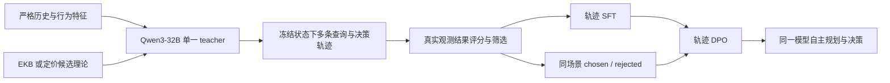

# 目录、实现与业务目的审计（2026-11-19）

服务器根目录：`/root/autodl-tmp/zhz/llm_simulation`。正式代码：`ecommerce-agent-simulation/agent_simulation`。本轮逐模块检查正式源码，核对目录、实验依赖、历史脚本语法与检查点，并对发现的缺陷补回归。依赖环境、第三方包、模型和原始数据按资产检查，不宣称逐行审计第三方实现或重跑所有历史实验。

## 实现地图

| 目录 | 当前功能与检查重点 | 状态 |
|---|---|---|
| `data/` | 官方划分、源文件绑定、经营事实、Catalog、历史截止、公开市场查询 | 修复背景重建源绑定和跨层依赖；原始价格保留未知单位 |
| `datasets/` | 标签、整请求分批、Seller 目标、抽样、Token 缓存、答案 mask | 修复二次抽样源校验与 train 限制；当前只支持最终动作 SFT |
| `agents/` | Customer/Seller、上下文、检索、记忆、决策循环 | 修复 Customer 原子冻结与取消轨迹终态；统一 raw price 证据规则 |
| `environment/` | 权限、市场版本、价格生效、搜索、待结算请求、反馈和记忆存储 | 检查状态事务、归属与独立时钟；没有发现需改的确定缺陷 |
| `simulation/` | Tick、并发草案、统一结算、退出与回放 | 检查 Seller→Customer 调度及失败传播；没有新增业务功能 |
| `inference/` | Transformers、vLLM、原生工具协议、容量与日志 | 修复 agentic seed 与模型身份日志不同步 |
| `training/` | 加权 LoRA、缓存读取、DDP、断点恢复与定期存盘 | 保留已有存盘改动；检查损失、配置和完整恢复状态 |
| `platform/` | 随机/BM25/DPR 召回、官方排序、重排接口 | 恢复上游原文件哈希，年龄字段兼容移到本项目适配层 |
| `evaluation/` | 条件行为预测、价格干预、搜索相关性、宏观轨迹 | 修复续跑身份校验、异常分类、AP；补 Seller 与规划使用量诊断 |
| `logs.py` | 原始模型输出、Agent 轨迹、原子报告 | 原子 JSON 写入移到 data 公共层，日志层复用 |
| `tests/`、README、`docs/` | 回归、真实命令入口、实现边界 | 补必要回归，移除不存在的调试文档链接与旧环境描述 |

## 已修复的具体问题

1. 数据构建导入运行日志模块，破坏 data 层独立性。原子替换 JSON 现在由 `data/common.py` 提供；原 `save_json` 的禁止覆盖语义保持不变。
2. KuaiSearch vendored collator 直接加入 `age_bucket` 补丁，和固定来源哈希矛盾。恢复上游文件，在 `platform/pipeline.py` 加年龄字段适配，测试真实 collator 数值未改变。
3. 临时向量缓存测试误用生产 8GiB 空间预留。测试显式设置 0 预留；生产预留及低空间拒写测试保留。
4. Customer 背景重建能接受不同 Ranking 文件。现在校验原 Catalog 的源 SHA，并检查读取期间源文件大小与修改时间。
5. Seller 二次抽样能给被修改的候选重新生成合法清单。现在逐项校验源候选 SHA、role、split 与固定文件名。
6. 扩展 Seller 报价间隔时未落实“只用 train、每商品一次、保留原集合”约束。现在拒绝非 train、重复或不在训练池的旧记录。
7. Customer agentic 分开读取 snapshot 与 revision，可能形成不一致的配对。现在使用单次原子 freeze，并拒绝传入已经过期的阶段状态。
8. 并发取消可能留下 running 轨迹。现在记录 failed 终态并原样传播取消，不提交动作。
9. 多轨迹更新 seed 后，日志仍可能记录初始化 seed。模型身份现在动态反映实际采样参数。
10. Agentic 评估把所有异常记作模型 invalid。现在只捕获模型输出/预算/容量错误；存储、服务器、权限与代码故障中止实验。
11. CLI 提供不存在的 `validation` 发布分区，且 greedy 可重复采样多条。现在只接受 train/test，多轨迹要求正温度。
12. 条件行为预测续跑只看文件名。现在核对 sample ID、stage、目标、可见 Prompt/schema 指纹、输出合法性与 Seller 前价。旧结果缺指纹时需新建输出目录，不静默混用。
13. 相关性评估对全正候选误记 AP 为空。现在 AP 为 1，单类别 ROC-AUC 仍无定义。
14. 原始价格单位文案在“分”和“未知 raw”之间矛盾。统一保留原尺度，不做数值换算，不推断货币或心理尾数定价；新缓存身份记录该提示语义版本。

Seller 报告补充了三方向混淆矩阵/macro-F1、变价召回、持平误调价率、变价幅度误差、按商家平均 MAE、保持前价的价格误差。全部仍与有效输出覆盖率一起报告。规划报告记录真实工具调用、理论参考读取与行为假设数量，不能用“开启 theory”代替“使用理论”的证据。

## 目录保留与清理依据

| 位置 | 用途及处理 |
|---|---|
| `ecommerce-agent-simulation/models` | 约 138G，Qwen3-32B teacher、9B/27B/3B 对照、BGE 和平台资产；保留 |
| `ecommerce-agent-simulation/data` | 约 20G，配置与原始/构建事实；保留 |
| `ecommerce-agent-simulation/runs` | 约 9.7G，发布事实、Token 缓存、检索缓存和历史运行；按来源保留，不能全部当临时目录 |
| `ecommerce-agent-simulation/result` | 约 65G，实验脚本、证据、检查点和链接依赖；历史脚本不作为正式模块，保留复现依据 |
| `result/customer-pointwise-controlled-vxIJH7` | 最新逐商品训练；checkpoint-250/251 及优化器/调度器/RNG/Trainer 状态保留 |
| `result/customer-response-pointwise-0kjh93` | 被最新实验的 base 与 epoch10-scores 链接引用；保留 |
| `result/lite-5pct-quality-3k-20261112/release` | 1k/500 等实验复用的发布数据；保留 |
| `result/lite-5pct-quality-1k-20261112` | 旧 SFT 训练、基线、示例依赖；保留 |
| `result/reflection-budget-worktree` | 已登记的独立 Git worktree；不按普通结果目录移动或删除 |
| `environments/` | 正式 train/vllm 环境、解释器与工具；旧环境路径已移除 |
| `references` | 参考项目与 KuaiSearch 源数据；保留 |
| 原 `runs-kernel-bench` | 2026-11-21 依赖迁入正式 train 环境，历史启动脚本已更新；性能测试记录移至 result |
| `cache` | 补充依赖已迁出，仅保留可再生缓存 |
| `env.sh`、`state`、`.github-ssh` | 环境配置、状态与认证；认证不入 Git。2026-11-21 恢复原 GitHub 密钥并验证 fetch，清除未授权的替换密钥 |

前一轮清理了失败温度实验、重复安装包和一次性脚本。2026-11-21 按用户要求删除了清理归档和两次源码部署备份；这些备份目前已不存在。随后清理四个可再生缓存和两份临时测试副本，实际释放约 9.8GiB。正式模型、数据、检查点、检索缓存和实验结果保留。后续服务器操作限定在 `llm_simulation` 内。

固定 SFT 的 `prompts/skills/customer-shopping.md` 与自主模式的 `customer-shopping/SKILL.md` 分别服务不同入口，不是误复制。官方排序源和本地适配层也不能合并，否则无法保持上游来源校验。测试镜像已清理；审计日志与补丁清单仍保存在 result，作为本机证据，不进入 Git。

## 审计时与研究目标的对应

以下状态保留审计完成时的记录。用户随后授权的轨迹生成、Seller 自主模式、轨迹 SFT/DPO 与传统基线已另行实现，当前功能与命令见[轨迹训练](trajectory-training.md)。

最终目标仍是每个角色用同一个模型完成“选择查询→读取证据→决定停止→输出动作”。Teacher 和 student 是训练阶段，不是运行时把规划与动作交给两个不同模型。

| 环节 | 现有状态 | 后续验收条件 |
|---|---|---|
| Customer 自主查询 | 已有可开关的 Qwen3-32B、只读权限、预算、冻结、日志 | 实测信息选择是否因人而异，以及查询的增量收益 |
| EKB 显式解释与轨迹 | 审计后已增加直接理论输入、简短依据和完整轨迹，thinking 关闭 | 生成可见、可检验的简短依据和工具轨迹；不能把生成解释当真实心理标签 |
| Seller 自主规划 | 审计时为固定上下文，随后已增加自主模式 | 复用统一循环、只读经营/竞品查询，理论作为可否定候选 |
| 筛选与轨迹 SFT | 审计后已提供独立生成、筛选与训练入口 | teacher 输入隐藏当前目标；结果仅用于生成后评分；加入工具角色与多轮 assistant mask |
| DPO | 审计后已提供轨迹 DPO 入口 | 同人同初始状态配对；分支使用各自实际工具返回；冻结 SFT reference；只对 assistant 生成 token 算概率 |
| Seller 传统基线 | 审计后已补齐统计、竞品和监督模型 | 补滚动中位数/EWMA、竞品相对价/分位、两阶段变价模型、同事实 GBDT |

轨迹 DPO 必须 mask system/user/tool 返回。若只训练共同证据下的最终 JSON，只能称为决策 DPO，不能称为查询策略训练。偏好来自复现观测行为的弱监督，未点击不等于讨厌，接近观测报价不等于利润最优。全错场景保留并报告，不能自动称为噪声。

传统 Seller 模型、固定信息 LLM、自主查询 LLM 必须使用同一目标、cutoff、候选市场与信息权限。依次比较历史信息增益、数值建模差异、规划增益、理论增益与 DPO 增益，不能把它们混在一次模型大小对照里。Seller 当前持平最多保留为变价的 4 倍、变价权重默认 2，应做不加权/原分布对照，判断误调价是否来自训练分布。

研究依据为 [Mirroring Users 正式论文](https://aclanthology.org/2026.acl-long.273/) 的理论辅助生成、筛选、SFT+DPO 路线；其固定候选单选任务不等于本项目工具轨迹，多标签 Customer 和连续 Seller 报价属于扩展。[Marketing Management 第 17 版](https://www.pearson.com/en-us/subject-catalog/p/marketing-management/P200000010451/9780138184889) 提供定价分析背景，具体传统模型矩阵是本项目实验设计，未声称逐项照搬教材。

## 证据与限制

测试与目录清单位于 `result/directory-review-20261119/`，包括完整回归、静态检查与修改前后 SHA；其中早期部署记录所指备份已按用户要求清除。最终结果以该目录的 `validation.json` 为准。

当前旧训练明确用 Test loss 选 checkpoint。已有 test 不能称为未使用的最终检验集；下一阶段必须冻结训练内验证与新的最终评估协议。静态 profile 无源快照日期、历史曝光不完整、商家成本缺失、报价观察索引不等于自然日。价格和销量的相关关系不能识别因果弹性。此次测试证明已检查的代码契约通过，不证明模型已经复现真实人的认知或长期行为。
